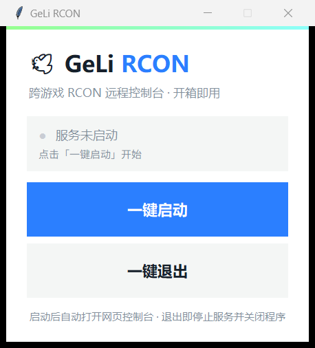

# 🕊️ GeLi RCON

> **GeLi RCON** — a zero-dependency, cross-game RCON console.
> **GeLi RCON** —— 零依赖、跨游戏的 RCON 远程控制台。
> **GeLi RCON** —— 依存関係ゼロ、マルチゲーム対応の RCON コンソール。

Supports **Minecraft, CS:GO / CS2 / GMOD / TF2 (Source), Rust, ARK, Palworld** and almost any game server using the RCON protocol.

支持 **Minecraft、CS:GO / CS2 / GMOD / TF2（Source 引擎）、Rust、ARK、Palworld** 等几乎所有使用 RCON 协议的游戏服务器。

**Minecraft、CS:GO / CS2 / GMOD / TF2（Source）、Rust、ARK、Palworld** など、RCON プロトコルを使用するほぼすべてのゲームサーバーに対応。

---

## ✨ Features · 功能 · 特徴

- **Single-file desktop app** — one-click start / quit window (Python + tkinter)
  **单文件桌面程序** —— 一键启动 / 一键退出的弹窗（Python + tkinter）
  **単一ファイルのデスクトップアプリ** —— ワンクリック起動 / 終了ウィンドウ（Python + tkinter）

- **Web console** — multi-server management, command history, presets, watch & batch mode
  **网页控制台** —— 多服务器管理、命令历史、快捷命令、监控模式、批量执行
  **Web コンソール** —— マルチサーバー管理、コマンド履歴、プリセット、監視・バッチ実行

- **Zero dependencies** — pure standard library (Python) / built-in modules (Node)
  **零依赖** —— 纯标准库（Python）/ 内置模块（Node）
  **依存関係ゼロ** —— 標準ライブラリのみ（Python）/ 組み込みモジュール（Node）

- **Large responses** — multi-packet responses are auto-joined
  **大响应** —— 自动拼接跨数据包分片的大响应
  **大きな応答** —— マルチパケット応答を自動結合

- **CLI mode** — single command & interactive mode for scripting
  **命令行模式** —— 单条命令与交互模式，便于脚本自动化
  **CLI モード** —— スクリプト用の単一コマンド＆対話モード

---

## 🎨 Brand · 品牌 · ブランド

| | |
|---|---|
| Name · 名称 · 名称 | GeLi RCON |
| Mascot · 吉祥物 · マスコット | 🕊️ |
| Colors · 配色 · カラー | 白色主调 · White base · 白ベース<br>蓝色主色点缀 · Blue primary accent · 青のメインアクセント `#2B7FFF`<br>浅绿次色点缀 · Mint secondary accent · ミントのサブアクセント `#96FF8F → #8DFFFA` |

---

## 🖼️ Preview · 界面预览 · プレビュー



---

## 🚀 Quick Start · 快速开始 · クイックスタート

**Desktop · 桌面版 · デスクトップ**

```
双击 dist/GeLi-RCON.exe     # 或 / または: python rcon_console.py
double-click dist/GeLi-RCON.exe
```

**CLI · 命令行 · コマンドライン**

```bash
node server.js --host 127.0.0.1 --port 25575 --password secret --command "list"
node server.js --host 127.0.0.1 --port 25575 --password secret --interactive
```

**Test without a real server · 无需真实服务器测试 · 実サーバーなしでテスト**

```bash
node test/mock-server.js   # 127.0.0.1:25575, password: test123
```

**Build the exe · 打包 exe · exe をビルド**

```bash
pip install pyinstaller
pyinstaller --onefile --windowed --name GeLi-RCON rcon_console.py
```

---

## 📁 Structure · 项目结构 · 構成

```
├── rcon_console.py      # 单文件桌面版（Python + tkinter）/ single-file desktop app
├── rcon.js              # RCON 协议客户端 / protocol client
├── server.js            # Node 后端 + CLI / Node backend + CLI
├── public/index.html    # Web 控制台 / web console
├── test/mock-server.js  # 模拟服务器 / mock server
└── package.json
```

---

## 📄 License · 许可证 · ライセンス

[MIT](LICENSE)
